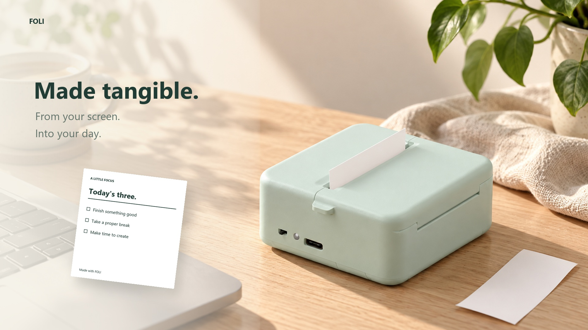
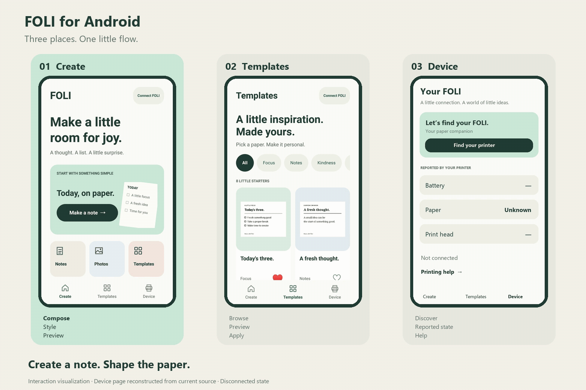
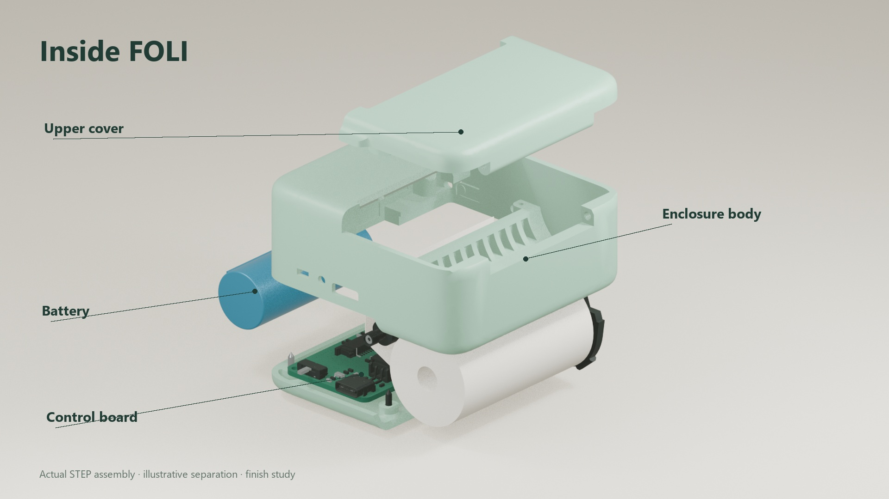

<h1 align="center">Little prints. Everyday joy.</h1>

让一份小小的想法，从手机走到纸上。

<a href="README.md">English</a> · <strong>简体中文</strong>

<a href="releases/README.zh-CN.md">下载 Android</a> · <a href="docs/zh-CN/getting-started.md">快速开始</a> · <a href="docs/zh-CN/index.md">工程文档</a>

**[观看 90 秒产品片 →](media/video/FOLI-Made-Tangible-90s.mp4)**

FOLI 是一个完整的便携热敏打印机项目：电池供电的 ESP32 电路、嵌入式控制、可打印外壳和原生 Android 应用，共同将便签、清单与心意变成小小的黑白纸条。

一张待办放在键盘旁，一段鼓励夹进礼物，一份清单随身带走。

*生活场景为概念视觉，产品结构基于实际 CAD；影片含交互重建和三维出纸示意。*

## 一份内容，三个入口

| Create | Templates | Device |
|---|---|---|
| 编辑文字、选择纸面风格、检查黑白预览 | 从八个模板出发，筛选、收藏与应用 | 发现设备、查看上报状态与打印帮助 |

无需账户，编辑和预览可离线使用；实际打印需要匹配设备。演示采用真实界面与交互重建，Device 为当前源码重建的未连接页面。

[下载 0.2.1 开发版](releases/android/FOLI-0.2.1-debug.apk) · [Android 源码与构建](software/android/README.zh-CN.md)

## 从软件到纸张

同一份排版先生成 384 点宽的单色光栅，再以每行 48 字节通过 BLE 发送到固件，由固件协调打印头与走纸。外壳把电源、电路、纸卷和机构整合为完整产品。

[架构与协议](docs/zh-CN/architecture.md) · [硬件文件](hardware/README.zh-CN.md) · [机械与装配](mechanical/README.zh-CN.md) · [固件源码](software/firmware/)

## 让体验成立的工程选择

- **预览要反映实际光栅。** 纸面预览和发送数据共用编码路径，避免把美化稿当成打印结果。
- **低配置手机也是设计条件。** 小米 6 的实际检查推动了键盘布局、编辑控件和复选框绘制的改进。
- **连接、发送与完成是不同状态。** 中断和未确认任务采用保守恢复策略；固件加固覆盖命令组行和故障停止路径。

[完整工程案例](docs/zh-CN/product-case-study.md) · [验证范围与已知限制](docs/zh-CN/verification.md)

## 真实硬件，真实纸张

实物硬件已装配并历史打印成功。Android 0.2.0 曾在小米 6 上检查界面与 BLE 状态；0.2.1 包含蓝牙异常恢复修复和软件检查。此次加固后的固件与新 App 尚未重新完成整机打印验证。

## 开始探索

| 你想做什么 | 入口 |
|---|---|
| 先试应用，无需打印机 | [安装和使用](docs/zh-CN/getting-started.md) |
| 构建 Android | [JDK、SDK 与构建命令](software/android/README.zh-CN.md) |
| 编译、烧录固件 | [PlatformIO 工程](software/firmware/README.md) |
| 查看或制造电路 | [最终工程、BOM 与制造导出](hardware/README.zh-CN.md) |
| 制作外壳 | [STL、文件映射与装配说明](mechanical/README.zh-CN.md) |
| 复用产品媒体 | [素材来源与重建](media/README.zh-CN.md) |

## 项目维护

本仓库保留原 Mini-Printer 历史，并整合 FOLI 原生 App、产品设计、机械文件、媒体与可靠性改进。[来源与贡献说明](docs/zh-CN/provenance.md)区分已有基础与新增实现。

[路线图](ROADMAP.md) · [参与贡献](CONTRIBUTING.md) · [发布与版本](releases/README.zh-CN.md) · [许可](LICENSE) · [第三方与素材说明](NOTICE.md)
