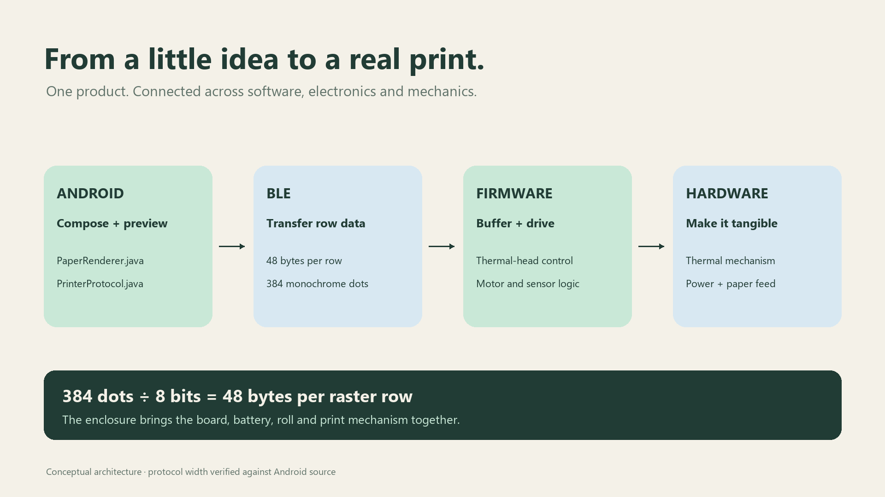

# 从排版到纸张

[English](../en/architecture.md) · [文档导航](index.md)

## Android：预览与传输共用光栅

`PaperRenderer` 排版文字或导入图片，`PrinterProtocol` 转换为 384 点宽的黑白光栅，每行 48 字节、黑点为 1，每字节最高位对应第一个点。预览根据编码结果生成，而不是另画一张与打印数据无关的装饰缩略图。

当前 App 最多接受 768 行。这是输入上限，不是打印时间保证。过长文本被拒绝；高图片缩放适配，不由编码器静默截断。

[Android 源码目录](../../software/android/app/src/main/java/studio/foli/android/)包含 `MainActivity`、`PaperRenderer`、`PrinterProtocol`、`BlePrinter`、`TemplateCatalog` 和 `ZoomPaperView`。

## BLE：收到数据不等于打印完成

| 字段 | 内容 |
|---|---|
| Service | `4fafc201-1fb5-459e-8fcc-c5c9c331914b` |
| Characteristic | `beb5483e-36e1-4688-b7f5-ea07361b26a8` |
| 浓度 | `A5 A5 A5 A5 01/02/03` |
| 发送结束／启动触发 | `A6 A6 A6 A6 01` |
| 状态 | 电量、温度、纸状态、打印状态，共四字节 |
| 纸状态 | 0 有纸；1 缺纸 |
| 打印状态 | 0 初始；1 启动；2 工作；3 结束 |

FOLI 使用带响应的 GATT 写入发送完整光栅行，要求协商 MTU 至少为 51。节拍和限制见 [Android 指南](../../software/android/README.md)。不能把旧资料中任意 20 字节拆包的建议直接替换为当前 App 的整行传输约定。

GATT 写入回调说明传输被接收，旧协议没有任务 ID、逐行序号和应用级校验。界面区分已连接、正在发送与设备上报的打印状态；没有观察到预期状态序列时显示不确定，而不直接报成功。重启恢复是有意设计，因为重连不会自动清空旧任务。

## 固件：缓存、加热、走纸

[固件](../../software/firmware/)接收命令与光栅行，缓存后将数据移入打印头、锁存、分组加热并驱动电机走纸，电量、缺纸和温度参与状态处理。准确时序和引脚映射以选定配置和最终板卡为准。

仓库加固将旧版命令继续入队与故障状态问题和历史实物测试分开记录。构建或主机测试通过，不代表这些修改已完成实物验证，边界见[验证记录](verification.md)。

## 电路与结构

板卡集成控制、充电与稳压、打印头电源、电机驱动和检测接口。旧图与文档有差异时，应以[最终硬件工程](../../hardware/EDA-project/foli-mainboard.epro2)核实，不能根据文件名猜测。

外壳定位控制板、电池、打印机构和纸卷。[装配文档](assembly.md)链接打印件并列出尚未记录的制造信息。带标注的展开图用于解释部件关系，不代表实际装配顺序或已验证的运动机构。

## 本地数据

App 无账号、后端、分析服务或 Internet 权限。文字、收藏和降采样图片副本保存在本机；蓝牙权限用于发现与连接，图片通过系统文档选择器导入。这是实现说明，不是安全认证。无障碍、生命周期和兼容性仍有待扩大验证。
