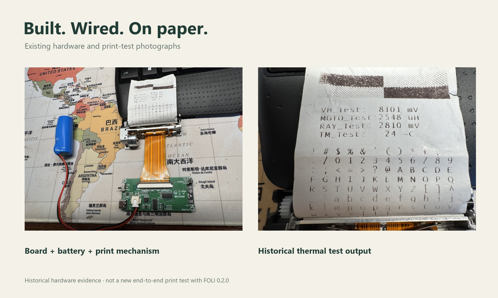

# 验证范围与剩余边界

[English](../en/verification.md) · [文档导航](index.md)

证据按实际能证明的范围分类。渲染不是硬件证据，编译不是无线联调，历史打印成功也不能验证所有新软件版本。

| 范围 | 已记录证据 | 不能由此推导 |
|---|---|---|
| 硬件 | 现有控制板／机构照片与实物热敏测试页 | 量产良率、耐久、容量或新版 App 兼容 |
| Android 0.2.0 | 构建、Lint、158 条协议断言、APK 签名、安装及部分交互检查 | 所有图片路径、生命周期、系统版本或实物打印 |
| Android 0.2.1 | 构建、Lint、签名、编码/权限异常/终态判定主机检查 | 新版真机安装、实际撤销权限或实物打印 |
| 手机 | 小米 6，Android 8/API 26 | 通用 FPS、性能或完整无障碍认证 |
| BLE 基线 | 连接及四字节状态接收；约 75–76% 电量；缺纸状态符合空机 | 电量标定、可靠温度或纸面输出 |
| 仓库加固 | 与变更源码对应的构建及自动检查 | 新固件修复的实物资格验证 |
| 产品媒体 | CAD、UI 重建、AI 生活概念和原创合成声音 | 实拍使用、真实动画性能或新增打印测试 |

[Android 详细记录](../../software/android/VERIFICATION.md)按时间保存观察。开头表格属于初始构建交接，应继续阅读后面的真机与 0.2.0 章节。

该照片的测试页显示 `TM_Test: 24 °C`。没有另一份证据时，不能为此图沿用旧 README 中的 28 °C。

## 已观察的交互

0.2.0 检查了模板列表、Focus 筛选、模板预览与应用、Clean→Journal 实时预览、Keep changes、Undo、收藏和 Saved 筛选；全屏编辑器在键盘上方保留 Cancel/Done，取消临时标题修改恢复原内容；全屏纸面查看可以打开。最终限定范围内的进程日志未出现致命异常。

单次启动光栅耗时不是持续性能测试。多点触摸、全部图片导入／变换、大字体、无障碍服务、进程重建及新系统仍需扩大验证。

## 未解决的实物联调

空机连接时打印头温度上报为 `0 °C`。用户提出可能仅打印时更新温度，这是待核实解释，不是传感器正常的证据，零不能当作已标定的安全温度。该次观察没有发送打印。

历史协议缺少任务标识、逐行序号与应用级校验，也没有能保证停止已开始打印的取消命令。中断可能遗留缓冲；旧固件完成／超时行为与 A6 继续入队是已知限制。对这些问题的修复需单独记录构建、主机测试与后续实物状态。

本轮没有重新验证 FOLI 0.2.0 或仓库加固固件的完整纸面输出。用户选择不重复硬件测试；这不阻止开放源码，但限制兼容性承诺。

## 后续验证如何记录

记录硬件版本、固件提交、App 版本／校验值、手机与 API、电池／纸张条件和准确输入。每项保存预期、观察、日志／照片及通过／失败／不确定结论，分别归类构建静态检查、编码协议测试、手机权限／发现、实际输出和异常恢复。

新增测试应更新对应源码版本，不能把历史工作追溯标为“全部测试通过”。

## 本次整合的软件检查

Android 0.2.1 构建/Lint通过（0错误、1条依赖版本建议），158条编码断言、蓝牙异常边界、8种共享终态判定与7种温度场景及APK v2签名检查通过。状态3仅作为停止/未确认，不证明打印成功；重启打印机后显式确认才清除恢复标志。

固件使用PlatformIO Core6.2.0、espressif32 7.0.1、Arduino-ESP32 2.0.17编译通过。共享C++检查覆盖命令、6种分片、整行、溢出、复制独立性与10000次环形回绕。RAM 88012/327680字节，Flash 1151529/1310720字节，为构建大小而非运行性能。

未烧录、未新增实物打印。传感器校准、时序与新的故障停止行为仍待实物验证。
